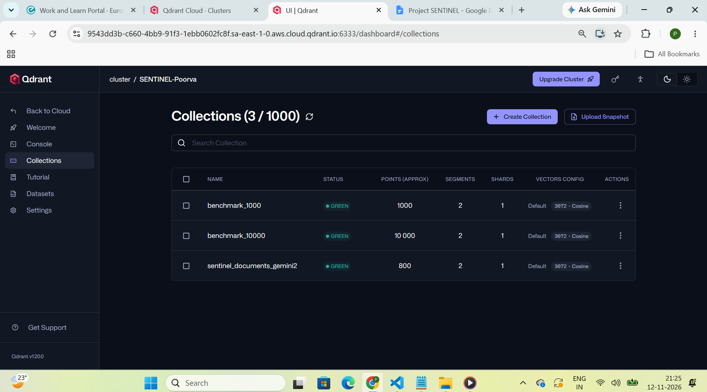
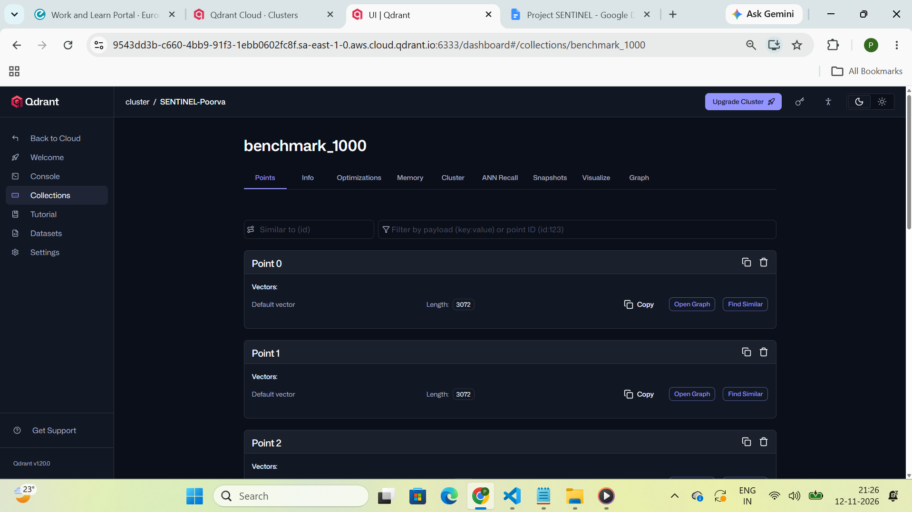

# Vector search internals, cosine vs Euclidean from scratch

## 1. Project Overview

This project explores the internal working of vector similarity search by implementing Euclidean Distance and Cosine Similarity from scratch using Python and NumPy.

It compares manual brute-force vector search with Qdrant vector search using Gemini Embedding 2 vectors from the previous SENTINEL project.

The project also demonstrates vector normalization, explains why normalized Dot Product and Cosine Similarity produce identical rankings, and benchmarks search performance using 1,000 and 10,000 randomly generated vectors.

Finally it explores how an HNSW (Hierarchical Navigable Small World) index improves approximate nearest-neighbor search.

## 2. Project Structure

```text
Vector Search Internals/
├── Screenshots
├── code.ipynb
├── requirements.txt
├── README.md
├── .env
├── .env.example
└── .gitignore
```

### Files Description

- `Screenshots`: Contains screenshots of the output.
- `code.ipynb`: Contains implementations, experiments, vector comparisons, and performance benchmarks.
- `requirements.txt`: Lists the required Python libraries.
- `.env`: Stores private Qdrant connection credentials.
- `.env.example`: Provides a template for the required environment variables.
- `.gitignore`: Prevents sensitive files and unnecessary files from being committed to GitHub.


## 3. Setup Instructions

### Step 1: Clone the repository

```bash
git clone <your-repository-url>
cd Vector Search Internals
```

### Step 2: Create a virtual environment

```bash
python -m venv venv
```

Activate it:

**Windows:**
```bash
venv\Scripts\activate
```

### Step 3: Install dependencies

```bash
pip install -r requirements.txt
```

### Step 4: Configure environment variables

Create a `.env` file in the project root.

Add your Qdrant credentials:

```env
QDRANT_URL=your_qdrant_url
QDRANT_KEY=your_qdrant_api_key
```

Use `.env.example` as a template:

```env
QDRANT_URL=
QDRANT_KEY=
```

**Security Note:**

Never commit API keys, passwords, or other sensitive credentials to GitHub. Keep actual credentials inside `.env` and ensure `.env` is included in `.gitignore`. Commit only `.env.example` with empty placeholder values.

## 5. How to Run

### Step 1: Start Jupyter Notebook

```bash
jupyter notebook
```

### Step 2: Open the notebook

Open `code.ipynb`.

### Step 3: Execute the cells

Run the notebook cells sequentially to perform the experiments.


## 6. What Does an HNSW Index Change?

HNSW stands for **Hierarchical Navigable Small World**. It is a graph-based indexing algorithm used for Approximate Nearest Neighbor (ANN) search.

### Without HNSW

- The database may compare the query vector against every stored vector.
- This is known as brute-force or full-scan search.
- It provides exact nearest-neighbor results but requires more comparisons as the dataset grows.

### With HNSW

- Vectors are connected through a hierarchical graph.
- Search starts from higher graph layers and navigates towards promising nearby vectors.
- It explores selected candidates instead of exhaustively checking every vector.
- This can make searches faster for large datasets.

### Key Differences

| Feature | Brute-Force Search | HNSW Search |
|---|---|---|
| Search approach | Checks every vector | Navigates a graph |
| Accuracy | Exact | Approximate |
| Speed | Can become slower as data grows | Can improve scalability |
| Index structure | No graph index required | Hierarchical graph |
| Memory | Stores vectors | Stores vectors and graph connections |

**Important:** Qdrant uses HNSW as its default vector indexing method. However, its optimizer and indexing thresholds determine when the index is built. For smaller collections, Qdrant may use full-scan search instead.

HNSW introduces a trade-off between search speed, retrieval accuracy, indexing time, and memory usage.

## 7. Screenshots

### 7.1 Qdrant Cloud – Available Vector Collections


Shows the collections created and available in the Qdrant Cloud dashboard.

### 7.2 Points Stored in benchmark_1000 Collection


Shows the vector points stored inside the `benchmark_1000` collection.

